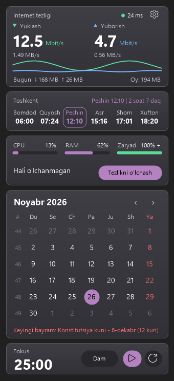

# Taqvim Widget

[O'zbekcha](README.md) · **English**

A lightweight Windows 10/11 widget: internet speed next to the taskbar clock, plus prayer times, calendar and notes in one flyout. The user interface is in Uzbek.



## Features

- Live speed on the taskbar, 60-second chart, daily and monthly traffic with an optional limit
- Ping indicator with offline/online notifications
- On-demand speed test
- Offline prayer times for 13 cities in Uzbekistan, with reminders
- Calendar with ISO week numbers, holidays and per-day notes with reminders
- CPU, RAM and battery meters, Pomodoro timer
- Windows 11 look, light/dark theme, accent color, DPI scaling

## Install

Download `TaqvimWidget-Setup.exe` from [Releases](../../releases/latest) and run it. No administrator rights and no extra runtime are needed (.NET Framework 4.8 ships with Windows 10 1903+ and Windows 11).

The binary is not code-signed, so SmartScreen may warn you. Each release includes a SHA-256 checksum, or you can build it yourself.

## Privacy

No telemetry, ads or accounts. Data stays in `%APPDATA%\TaqvimWidget`. The app pings `1.1.1.1` / `8.8.8.8` every 8 seconds to show connectivity, and contacts `speed.cloudflare.com` only when you start a speed test (which can use tens of megabytes). The live speed reading is taken from network adapter counters and costs no traffic.

## Prayer times

Times are computed locally using parameters matching those of [islom.uz](https://islom.uz). This project is **not** affiliated with islom.uz or any religious authority. See [docs/PRAYER_TIMES.md](docs/PRAYER_TIMES.md).

## Build

Requires [.NET SDK 8.0+](https://dotnet.microsoft.com/download).

```powershell
powershell -ExecutionPolicy Bypass -File .\build.ps1
```

See [Architecture](docs/ARCHITECTURE.md) (Uzbek) and [Contributing](CONTRIBUTING.md).

## License

[MIT](LICENSE)
