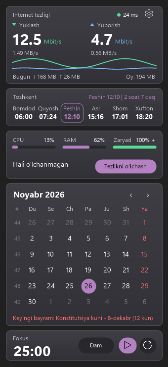

# Taqvim Widget

[](../../actions/workflows/ci.yml)
[](LICENSE)

**English** · [O'zbekcha](README.uz.md)

A lightweight Windows 10/11 widget: internet speed next to the taskbar clock, plus prayer times, calendar and notes in one flyout. The user interface is in Uzbek.



## Features

- **Internet speed:** shown on the taskbar next to the clock, with a 60-second chart, daily and monthly traffic, and an optional monthly limit.
- **Connectivity:** ping indicator, with notifications when the connection drops and returns.
- **Speed test:** runs only when you press the button.
- **Prayer times:** 13 cities in Uzbekistan, calculated offline. The current and next times are highlighted, with advance reminders.
- **Calendar:** ISO week numbers, holidays, and per-day notes with timed reminders.
- **System:** CPU, RAM and battery meters.
- **Pomodoro** timer.
- Windows 11 look, light and dark themes, accent color and DPI scaling.

## Install

1. Download `TaqvimWidget-Setup.exe` from the [latest release](../../releases/latest).
2. Run it and press **O'rnatish** (Install). Administrator rights are not required.

The binary is not code-signed, so Windows SmartScreen may warn you. Releases include a SHA-256 checksum, or you can build the installer yourself.

**Requirements:** Windows 10 (1903 or later) or Windows 11. No extra runtime is needed, because .NET Framework 4.8 ships with Windows.

**Uninstall:** Settings → Apps → Taqvim Widget.

## Usage

| Action | Result |
|---|---|
| Click the taskbar speed text or the tray icon | Open or close the widget |
| Right-click | Settings and exit |
| Click a day in the calendar | Notes for that day |
| Mouse wheel over the widget | Change month |

## Resource usage

Measured on one laptop over 60 seconds with the widget closed:

| Metric | Value |
|---|---|
| CPU (of a single core) | ~0.1% |
| Private bytes | ~27 MB |
| Private working set | ~9 MB |
| Installer size | ~150 KB |

Results vary between machines. See [Architecture](docs/ARCHITECTURE.md) (in Uzbek) for how the footprint is kept small.

## Privacy

There is no telemetry, advertising or account. Your data stays on your computer in `%APPDATA%\TaqvimWidget`.

The app uses the network only in these cases:

| When | Where | Why |
|---|---|---|
| Every 8 seconds | `1.1.1.1`, `8.8.8.8` | ICMP ping to show connectivity |
| Only when you start a speed test | `speed.cloudflare.com` | Speed measurement. One test can use tens of megabytes |

The live speed reading comes from network adapter counters and uses no traffic.

## Prayer times

Times are calculated inside the app, using parameters matched to those of [islom.uz](https://islom.uz). This project is **not** an official product of, or affiliated with, islom.uz or any religious authority. Check an official timetable when accuracy matters. Details: [docs/PRAYER_TIMES.md](docs/PRAYER_TIMES.md) (in Uzbek).

## Build

Requires [.NET SDK 8.0 or later](https://dotnet.microsoft.com/download).

```powershell
powershell -ExecutionPolicy Bypass -File .\build.ps1
```

The script runs the tests and creates `dist\TaqvimWidget-Setup.exe`. To run only the tests:

```powershell
dotnet test tests\TaqvimWidget.Core.Tests
```

## Project structure

| Path | Contents |
|---|---|
| `src/TaqvimWidget.Core` | UI-independent logic, covered by unit tests |
| `src/TaqvimWidget.App` | WinForms interface and Windows integration |
| `src/TaqvimWidget.Setup` | Per-user installer |
| `src/Shared` | Code shared by the app and the installer |
| `tests` | Unit tests |

## Known limitations

- The taskbar speed text is a window placed over the taskbar, not an official Windows API. A future Windows update could affect it. You can turn it off in Settings.
- Unit tests cover the core logic only, not the interface or Windows integration.
- Eid holiday dates are approximate.

## Contributing

See [CONTRIBUTING.md](CONTRIBUTING.md). Changes are listed in the [changelog](CHANGELOG.md) (in Uzbek).

## License

[MIT](LICENSE)
